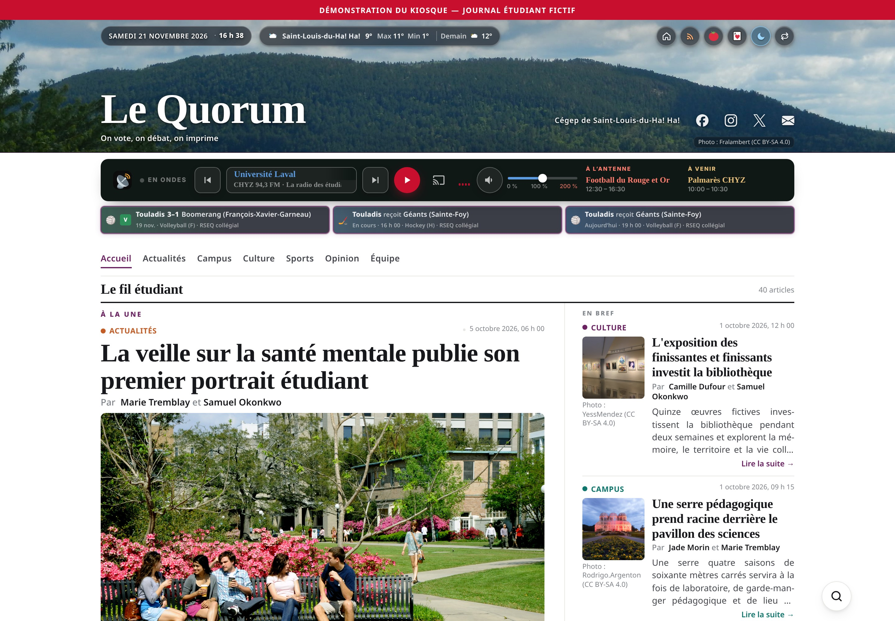
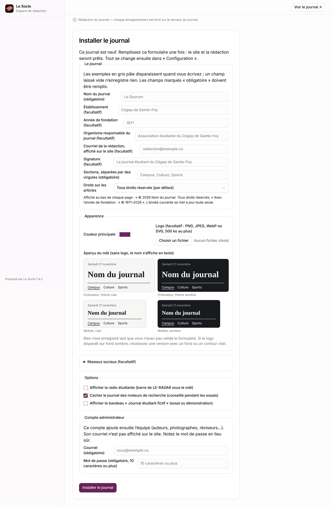
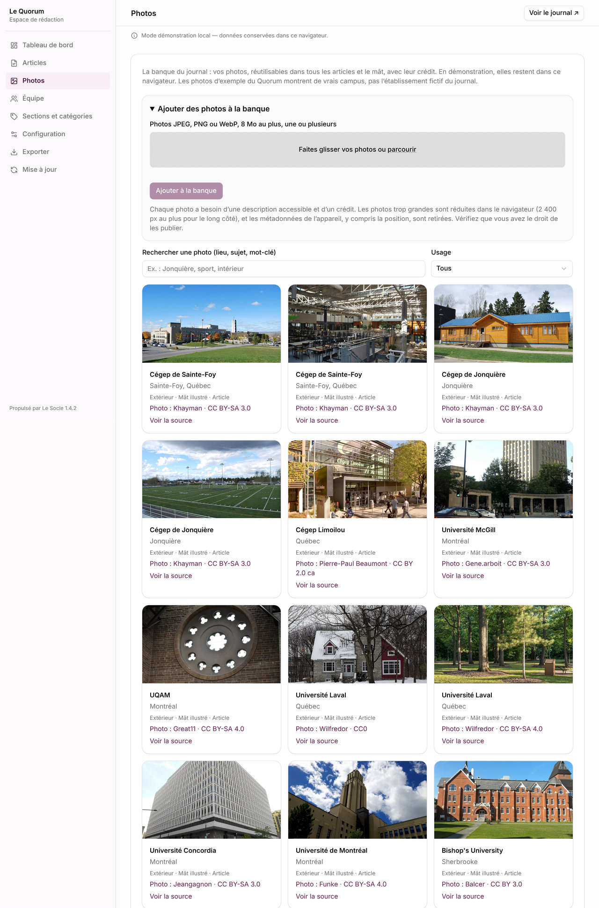

<picture>
  <source media="(prefers-color-scheme: dark)" srcset="site/assets/logo/icone-sombre.svg">
  
</picture>

# Le Kiosque

*Kit d’Infrastructure Ouverte, Souveraine et de Qualité pour les Usages Éditoriaux.*

**Plateforme libre pour les journaux étudiants.** Elle fournit le site Web public du journal et l’espace de rédaction, livrés ensemble dans un seul paquet.

Un journal étudiant ne disparaît presque jamais par manque de talent. Il disparaît parce que le domaine a expiré, que l’hébergement n’est plus payé, ou que le compte d’administration est parti avec quelqu’un qui a gradué. Le Kiosque répond à ce problème : chaque journal installe sa propre copie, sans dépendre d’aucun serveur central, et garde ses archives.

[](https://kiosque.le-radar.ca/demo/)

<p align="center"><em>Le Quorum, journal de démonstration — météo, sports, barre radio et fil d’articles.</em></p>

- **Page de présentation :** <https://kiosque.le-radar.ca/>
- **Démonstration :** <https://kiosque.le-radar.ca/demo/>
- **Guide d’une page :** <https://kiosque.le-radar.ca/guide/>
- **Paquet complet :** <https://github.com/azdak919/le-kiosque/releases/latest/download/kiosque-journal.zip>

Le Radar est l’agrégateur des médias étudiants. Le Kiosque est la plateforme qui permet d’en faire paraître un. Les deux projets sont distincts : un journal sous le Kiosque reste maître de son domaine, de son hébergement, de ses comptes et de ses contenus.

---

## À qui ça s’adresse

Aux équipes de journaux étudiants et de médias de campus qui veulent un site à elles, simple à transmettre d’une cohorte à l’autre. L’installation se fait dans le navigateur. Il ne faut ni ligne de commande, ni compte GitHub.

---

## Installer un journal

1. **Téléchargez** [`kiosque-journal.zip`](https://github.com/azdak919/le-kiosque/releases/latest/download/kiosque-journal.zip) — toujours la dernière version, à une adresse fixe.
2. **Déposez** le contenu du dossier `kiosque-journal/` à la racine de l’espace Web d’un hébergeur **PHP 8.1 ou plus récent, avec SQLite** (serveur du cégep ou de l’association, hébergeur habituel, ou essai gratuit chez [alwaysdata](docs/hebergeur-gratuit.md)). Un sous-dossier reste possible si vous le souhaitez.
3. **Ouvrez** `https://votre-journal.com/redaction/` et remplissez l’assistant : nom, rubriques, logo au besoin, compte administrateur. Attendez le message « Le journal est installé ».
4. **Écrivez**, relisez, publiez. L’article paraît tout de suite. Téléchargez une sauvegarde à chaque fin de session.

Le détail, pour un étudiant, tient dans le [guide d’une page](https://kiosque.le-radar.ca/guide/). Le [guide étudiant complet](docs/guide-etudiant.md) couvre aussi les autres chemins : site public sur GitHub Pages, serveur de l’établissement, auto-hébergement.

---

## Ce que fait la plateforme

**Sur le site Web public**

- Le mât affiche le nom du journal en grand ; s’il y a un logo, le logo remplace le nom. On peut y choisir plusieurs photos, affichées dans un ordre aléatoire.
- Rubriques, pages d’articles, pages des auteurs, recherche dans la page, mode sombre.
- Météo locale, résultats sportifs et barre radio, au choix. La radio est un module du [Radar](https://le-radar.ca), chargé depuis le-radar.ca.
- Chaque article porte tous ses auteurs ; chaque photo porte son crédit et sa licence.
- Sur la démonstration et sur un site statique (par exemple GitHub Pages) : archives, plan du site et fil RSS.

**Dans l’espace de rédaction** (c’est [le Socle](https://socle.le-radar.ca/) : l’interface d’administration et son serveur)

- Assistant d’installation dans le navigateur.
- Rôles : auteur, photographe, réviseur, chef de pupitre, éditeur, administrateur. Un auteur ou un chef de pupitre peut être limité à certaines rubriques.
- Banque de photos, avec crédit obligatoire.
- Aperçu de l’article dans le thème, sans le publier.
- Sauvegarde complète en un fichier ZIP, et restauration.
- Mise à jour en un clic, quand une version de la plateforme est publiée.



<p align="center"><em>L’assistant, à la première visite de l’espace de rédaction.</em></p>



<p align="center"><em>La banque de photos, avec crédit et licence.</em></p>


<p align="center"><em>Plusieurs photos de mât, et l’ordre aléatoire activé par défaut.</em></p>

---

## Travailler sur le code

```bash
git clone https://github.com/azdak919/le-kiosque.git
cd le-kiosque
npm ci
npm test
npm run site
```

`npm run site` construit la page de présentation, le configurateur et la démonstration Le Quorum dans `dist/`. Le guide de contribution et les invariants du projet sont dans [`AGENTS.md`](AGENTS.md).

---

## Licence et crédits / License

**Auteur du code** — Azdak (2026)

**Contact du projet** — [azdak-qc@proton.me](mailto:azdak-qc@proton.me)

| Partie | Licence | Fichier |
| --- | --- | --- |
| Code source : moteur, adaptateurs, thème, configurateur, outils | [GNU AGPLv3](https://www.gnu.org/licenses/agpl-3.0.html) (`AGPL-3.0-or-later`) | [`LICENSE`](LICENSE) |
| Site produit pour un journal (fichiers que le build écrit ou recopie dans son site) | Libre d’usage pour le journal, sans obligation de l’AGPLv3 | [`LICENSE-EXCEPTIONS.md`](LICENSE-EXCEPTIONS.md) |
| Extension WordPress (`wordpress/le-kiosque/`) | MIT | en-tête de `le-kiosque.php` |
| Articles, photos et nom de chaque journal | Propriété exclusive de leurs autrices, auteurs et de l’équipe qui les publie | — |

- Le Kiosque n’a pas de kit-média ni de scripts d’intégration propres. La barre radio vient de LE-RADAR : `radio-barre.js` y est sous MIT.
- Les photos de la démonstration gardent leur licence d’origine (CC0, CC BY ou CC BY-SA), listée dans [`THIRD_PARTY.md`](THIRD_PARTY.md), comme les autres composants tiers.
- Le logo du Kiosque, un kiosque à auvent rayé, est un dessin original publié sous la même licence que le logiciel.
- Le projet est indépendant. Il n’est affilié à aucun journal ni à aucun établissement.

*English:* the source code is under the GNU AGPLv3 (`AGPL-3.0-or-later`). An additional permission frees the site that Le Kiosque builds for a newspaper: the newspaper may modify its theme without publishing its code. Articles and photos belong to their authors and newspapers.

Projets liés : [LE-RADAR](https://github.com/azdak919/le-radar) (<https://le-radar.ca/>) et [LE SOCLE](https://github.com/azdak919/le-socle) (<https://socle.le-radar.ca/>), sous la même licence.

L’identité visuelle reprend celle du [Radar](https://github.com/azdak919/le-radar), sans y être liée : chaque projet peut évoluer de son côté.
